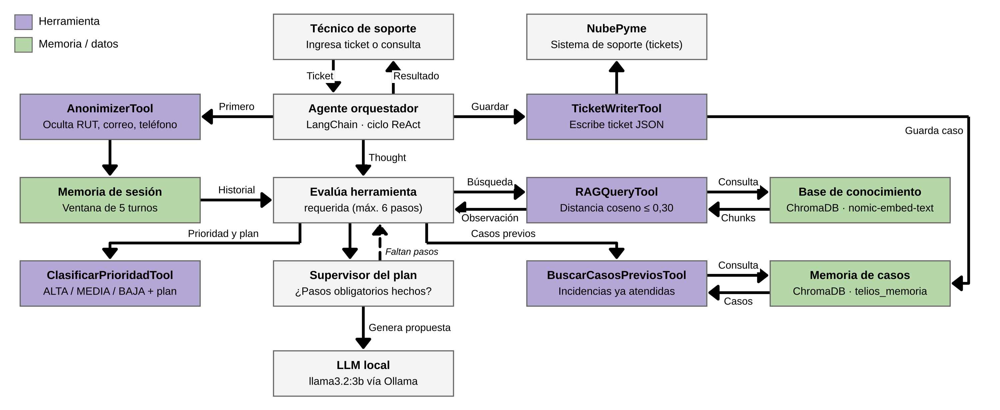

# Agente Telios — Soporte técnico NubePyme

Agente funcional de soporte de Nivel 2 para la plataforma **NubePyme Soluciones** (caso simulado).
Ayuda a los técnicos humanos a diagnosticar incidencias de Webpay/Transbank y de la plataforma:
clasifica la prioridad, consulta la base de conocimiento, recuerda casos anteriores, redacta una
propuesta de respuesta y registra el ticket. Corre **100 % local** con Ollama.

Proyecto de la Evaluación Parcial N°2 de *Ingeniería de Soluciones con IA* (ISY0101, Duoc UC).
Equipo Telios: Christopher Calderón, Marcela Mena, Benjamín Concha.

---

## Arquitectura



| Componente | Tecnología | Rol |
|---|---|---|
| Orquestador | LangChain (`langchain-core`, `langchain-ollama`) | Bucle ReAct con *tool calling*: el modelo decide qué herramienta usar en cada paso (`agent/core.py`) |
| LLM | `llama3.2:3b` vía Ollama, `temperature=0`, `num_predict=800` | Razonamiento y redacción. Soporta tool calling nativo |
| Embeddings | `nomic-embed-text` vía Ollama | Vectorización de documentos y consultas |
| Base vectorial | ChromaDB persistente (`chroma_db/`), distancia coseno | Base de conocimiento + memoria de casos |
| Memoria corto plazo | Ventana deslizante k=5 turnos, guardada en `sesiones/` | Repreguntas y continuidad dentro de una sesión |
| Memoria largo plazo | Colección ChromaDB `telios_memoria` | Recordar tickets atendidos en sesiones anteriores |

### Herramientas

| Tool | Tipo | Qué hace |
|---|---|---|
| `ClasificarPrioridadTool` | Razonamiento / planificación | Asigna prioridad ALTA, MEDIA o BAJA y devuelve el plan de pasos para esa prioridad |
| `RAGQueryTool` | Consulta | Búsqueda semántica en la base de conocimiento; devuelve fragmentos con `[FUENTE: archivo]` o `NO_INFO` |
| `BuscarCasosPreviosTool` | Consulta (memoria) | Busca incidencias similares ya atendidas |
| `TicketWriterTool` | Escritura | Guarda el ticket en `tickets_output/*.json` y en la memoria de largo plazo |
| `AnonimizerTool` | Seguridad (guardrail) | Oculta RUT, email y teléfono **antes** de que el modelo vea el texto (Ley N° 21.719). La ejecuta siempre el orquestador, no el modelo, porque no se puede anonimizar algo que el modelo ya leyó |

### Ciclo de decisión (ReAct + supervisor del plan)

1. **Guardrail 1:** se anonimiza la consulta.
2. Se reinyectan al modelo los últimos 5 turnos de la sesión (memoria de corto plazo).
3. El modelo decide qué hacer:
   - si es una incidencia nueva, llama a `ClasificarPrioridadTool` y recibe un plan según la prioridad;
   - si es una repregunta ("hazlo más breve"), la tool le avisa que no es una incidencia nueva y el modelo responde con la memoria, **sin consultar RAG**;
   - si el técnico pide guardar, llama a `TicketWriterTool`.
4. Cada resultado vuelve al modelo como observación, hasta que responde o se llega a 6 iteraciones.
5. **Supervisor del plan:** si el modelo intenta responder sin haber hecho los pasos obligatorios
   de su prioridad (por ejemplo, sin consultar `RAGQueryTool`), el orquestador los ejecuta y le
   devuelve el resultado antes de aceptar la respuesta. Es el rol de validador del *Manager* en la
   orquestación jerárquica. Se agregó porque en las pruebas reales `llama3.2:3b` tendía a responder
   después de la primera herramienta, inventando un "procedimiento oficial".
6. **Respuesta anclada a la fuente:** cuando `RAGQueryTool` encuentra información, las secciones
   técnicas (tipo, causa, solución, fuente) se toman textualmente del documento recuperado y el
   modelo solo redacta el mensaje al cliente usando esa información. En las pruebas, el modelo de 3B
   agregaba pasos que no estaban en la documentación; así se evita.
7. **Sin información documentada:** si `RAGQueryTool` devuelve `NO_INFO`, se detiene la generación y
   se usa una respuesta de protocolo (no se deja que el modelo invente).
8. **Guardrail 2:** si no hubo información y la prioridad es ALTA o MEDIA, el ticket queda `ESCALADO`
   a Nivel 3. Si la prioridad es BAJA, no se escala: se piden más detalles al cliente.

| Prioridad | Pasos obligatorios que exige el supervisor |
|---|---|
| ALTA | `BuscarCasosPreviosTool` y `RAGQueryTool` |
| MEDIA | `RAGQueryTool` |
| BAJA | `RAGQueryTool` |

### Planificación por prioridades

| Prioridad | Cuándo | Plan | Sin información |
|---|---|---|---|
| ALTA | El cliente no puede cobrar o vender (401 en producción, caída, rechazos) | Casos previos → RAG → borrador | Escala de inmediato a Nivel 3 |
| MEDIA | Error en una operación puntual (422, anulaciones) | RAG → casos previos → propuesta | Escala a Nivel 3 |
| BAJA | Consultas y configuración | RAG → respuesta | Pide más detalles, no escala |

Con varias incidencias (`--cola`), el agente las ordena ALTA → MEDIA → BAJA y en empates respeta
el orden de llegada.

### Parámetros de recuperación

- Fragmentos de 150 palabras con 30 de solapamiento (los documentos actuales son cortos, así que cada uno es un fragmento).
- Se recuperan 2 fragmentos; se aceptan solo los de **distancia coseno ≤ 0,30** (similitud ≥ 0,70) y que estén a menos de 0,08 del mejor resultado.
- Todos los parámetros están en `agent/config.py`.

---

## Estructura

```
Telios-Agente/
├── main_agent.py              # CLI del agente
├── requirements.txt
├── agent/
│   ├── config.py              # parámetros (modelo, umbrales, ventana de memoria)
│   ├── core.py                # orquestador: bucle ReAct, supervisor del plan, guardrails, cola
│   ├── tools.py               # herramientas LangChain
│   └── memory.py              # memoria corto plazo + ChromaDB (conocimiento y casos)
├── data/                      # base de conocimiento (.txt)
├── tests/
│   ├── evaluacion_ep2.py      # 9 casos de prueba → resultados_pruebas.md
│   └── cola_incidencias.json  # ejemplo de cola con prioridades mezcladas
├── docs/                      # diagrama de orquestación (.mmd y .png)
├── legacy/                    # versión 1 (flujo fijo), se conserva como referencia
├── chroma_db/                 # se crea al ejecutar
├── sesiones/                  # memoria de corto plazo por sesión (se crea al ejecutar)
└── tickets_output/            # tickets JSON (se crea al ejecutar)
```

---

## Instalación y ejecución

**Requisitos:** Python 3.10 o superior y [Ollama](https://ollama.com/) instalado y abierto.

```bash
ollama pull llama3.2:3b
ollama pull nomic-embed-text

git clone <URL-del-repositorio>
cd Telios-Agente
pip install -r requirements.txt
```

**Modo interactivo:**

```bash
python main_agent.py
```

Ejemplo de flujo para probar la memoria:

```
Técnico de Soporte > Cliente recibe error 422 al anular una compra con OneClick
Técnico de Soporte > Hazlo más breve, solo el mensaje para el cliente
Técnico de Soporte > Guarda ese borrador
Técnico de Soporte > memoria      (muestra lo que el agente recuerda)
Técnico de Soporte > salir        (indica el ID para retomar la sesión)
```

**Retomar una sesión** (continuidad entre ejecuciones):

```bash
python main_agent.py --sesion sesion_20261026_171500
```

**Cola de incidencias ordenada por prioridad:**

```bash
python main_agent.py --cola tests/cola_incidencias.json
```

**Pruebas** (genera `tests/resultados_pruebas.md`):

```bash
python tests/evaluacion_ep2.py
```

| # | Caso de prueba | Qué demuestra |
|---|---|---|
| 1 | Anonimización | Ley 21.719, guardrail previo al modelo |
| 2 | Priorización de la cola | Planificación ALTA > MEDIA > BAJA |
| 3 | Error 401 Webpay | Uso de herramientas y cita de fuente |
| 4 | Error sin información (MEDIA) | Decisión adaptativa: escala a Nivel 3 |
| 5 | Consulta sin información (BAJA) | Decisión adaptativa: no escala |
| 6 | Repregunta "hazlo más breve" | Memoria de corto plazo, sin volver a consultar |
| 7 | "Guarda ese borrador" | Escritura decidida por el agente |
| 8 | Casos previos | Memoria de largo plazo |
| 9 | Retomar sesión | Continuidad entre ejecuciones |

---

## Limitaciones conocidas

- `llama3.2:3b` es un modelo pequeño: tiende a responder después de la primera herramienta sin
  seguir el plan, a veces escribe la llamada a la herramienta como texto JSON o usa otro nombre de
  argumento. El supervisor del plan y los respaldos de `core.py` cubren esos casos, y los errores de
  las herramientas vuelven al modelo como observación para que se corrija. Un modelo más grande
  (por ejemplo `llama3.1:8b`) necesitaría menos intervención del supervisor.
- La detección de repreguntas e instrucciones de guardado es por palabras clave.
- La clasificación de prioridad es por reglas (palabras clave), lo que la hace predecible y
  auditable, pero no entiende sinónimos que no estén en la lista.
- La base de conocimiento es pequeña (3 documentos de ejemplo). Agregar más `.txt` a `data/` basta:
  se indexan automáticamente al iniciar.

## Uso de IA en el desarrollo

Se usaron ChatGPT (OpenAI) y Claude (Anthropic) como apoyo para revisar y depurar el código,
redactar documentación y generar el diagrama. El equipo revisó y validó todo el contenido.
